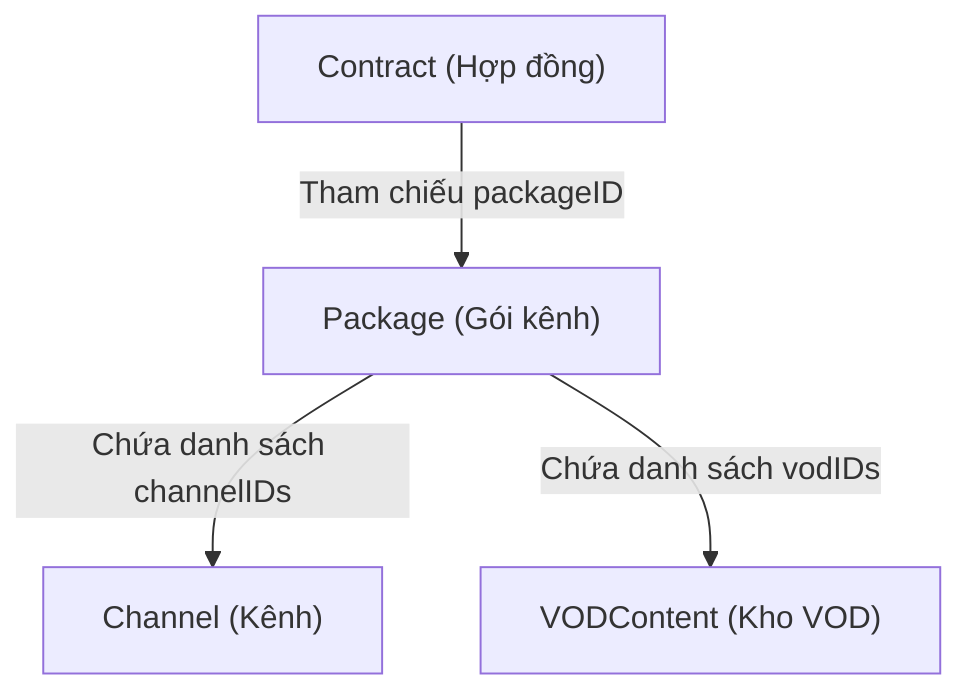
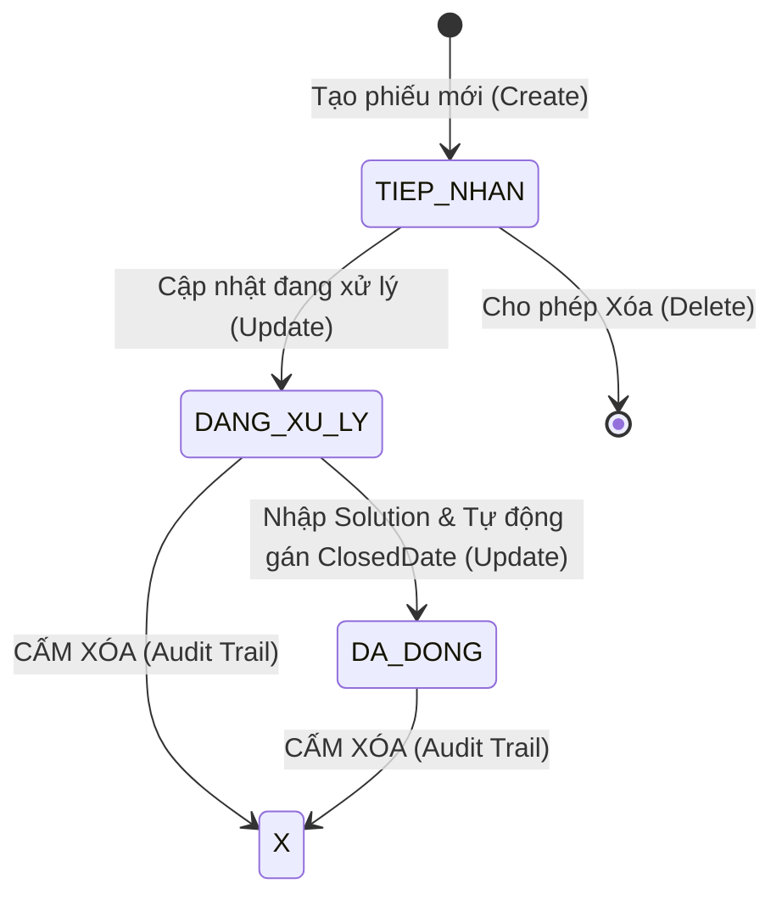

# Giải thích cơ chế: 2 Use Case `Package` & `SupportTicket`

> **Sinh viên thực hiện**: Dương Bảo Long (B24DCVT231)  
> **Hai Use Case phụ trách**:
> 1. Quản lý Gói kênh dịch vụ (`Package`)
> 2. Quản lý Phiếu hỗ trợ kỹ thuật (`SupportTicket`)

---

# PHẦN 1: USE CASE QUẢN LÝ GÓI KÊNH (`Package`)

## 1. Tổng quan & Vai trò kiến trúc
Trong hệ thống IPTV, **`Package` (Gói kênh)** là trung tâm của phần dịch vụ nội dung:
- Xác định quyền xem các kênh truyền hình (`Channel`) và nội dung theo yêu cầu (`VODContent`) của khách hàng thông qua hợp đồng (`Contract`).
- Mối quan hệ đa - đa ($N-N$) với Kênh và VOD được biểu diễn trực tiếp bằng 2 danh sách mã bên trong bản ghi gói (`vector<string> channelIDs`, `vector<string> vodIDs`), không tạo bảng trung gian bên ngoài.

---

## 2. Luồng dữ liệu (Data Flow)

### 2.1. Luồng tạo gói mới (`createPackage`)
1. Nhập tên gói $\rightarrow$ Kiểm tra không rỗng, không chứa ký tự cấm (`|`, `\r`, `\n`).
2. Nhập giá cước tháng $\rightarrow$ Kiểm tra $> 0$ (đơn vị: đồng).
3. Chọn trạng thái gói $\rightarrow$ Mặc định `DANG_CUNG_CAP` hoặc `NGUNG_DANG_KY`.
4. Nhập danh sách kênh $\rightarrow$ Quét từng mã, kiểm tra tiền tố `KENH`, tồn tại trong `Data/channels.txt`, không được trùng lặp và **phải $> 1$ kênh**.
5. Nhập danh sách VOD $\rightarrow$ Quét từng mã, kiểm tra tiền tố `VOD`, tồn tại trong `Data/noidungvod.txt`, không được trùng lặp và **phải $> 1$ VOD**.
6. Sinh mã tự động `GOIxxx` qua `repo.generateNextID()` $\rightarrow$ lưu RAM $\rightarrow$ ghi xuống `Data/packages.txt`.

### 2.2. Luồng xem & Sắp xếp gói (`readPackage` & `sortPackage`)
- Menu cho phép chọn:
  1. Xem toàn bộ danh sách gói.
  2. Tìm kiếm chi tiết theo mã `GOIxxx`.
  3. **Sắp xếp danh sách gói (`sortPackage`)**:
     - *Giá cước giảm dần (Đắt $\rightarrow$ Rẻ)*.
     - *Giá cước tăng dần (Rẻ $\rightarrow$ Đắt)*.
     - *Ưu tiên trạng thái `DANG_CUNG_CAP` lên trước*.
     - *Ưu tiên trạng thái `NGUNG_DANG_KY` lên trước*.
     - Sử dụng thuật toán `std::sort` với biểu thức Lambda trên bản sao vector trong bộ nhớ, không làm đảo lộn file dữ liệu gốc.

### 2.3. Luồng cập nhật (`updatePackage`)
- **Ràng buộc phụ thuộc hợp đồng**: Kiểm tra hàm `isPackageInActiveContract(pkg->getID())`.
  - **Nếu gói ĐANG nằm trong hợp đồng `ACTIVE`**: **Chỉ cho phép sửa duy nhất trường `Status`** (chuyển sang `NGUNG_DANG_KY` để chặn khách mới). Khóa hoàn toàn việc sửa Tên, Giá và Danh sách Kênh/VOD để bảo toàn quyền lợi hợp đồng của khách hàng hiện hữu.
  - **Nếu gói CHƯA có hợp đồng `ACTIVE` nào**: Cho phép sửa toàn bộ các trường (nhấn Enter để giữ nguyên giá trị cũ).

### 2.4. Luồng xóa (`deletePackage`)
- Tìm mã gói $\rightarrow$ Kiểm tra `isPackageInActiveContract()`.
- Nếu gói đang thuộc hợp đồng `ACTIVE` $\rightarrow$ **Chặn xóa**, báo lỗi vi phạm ràng buộc toàn vẹn tham chiếu.
- Nếu không có hợp đồng hoạt động $\rightarrow$ Hỏi xác nhận `(y/n)` $\rightarrow$ xóa khỏi `items` và cập nhật file.

---

## 3. Giải thích TẤT CẢ các hàm trong `Package` (Thực thể & Menu)

### 3.1. Các hàm trong lớp thực thể `Package` (`Entities/Package.h` & `cpp`)

| Tên hàm | Mục đích | Cơ chế hoạt động |
| :--- | :--- | :--- |
| `packageStatusToString(status)` | Chuyển enum sang string | Ánh xạ `PackageStatus` thành `"DANG_CUNG_CAP"` hoặc `"NGUNG_DANG_KY"`. |
| `stringToPackageStatus(str)` | Chuyển string sang enum | Chuyển chuỗi từ file thành enum; ném `invalid_argument` nếu chuỗi không hợp lệ. |
| `Package()` | Constructor mặc định | Khởi tạo gói rỗng với `monthlyPrice = 0`, `status = DANG_CUNG_CAP`, 2 vector rỗng. |
| `Package(id, name, price, ...)` | Constructor đầy đủ tham số | Gọi lần lượt các setter để gán và kiểm tra tính hợp lệ của tất cả các trường. |
| `setName(name)` | Gán tên gói | Kiểm tra không rỗng và không chứa ký tự `\|`, `\r`, `\n`. |
| `setMonthlyPrice(price)` | Gán giá cước tháng | Kiểm tra số tiền `price > 0`. |
| `setStatus(status)` | Gán trạng thái gói | Gán enum trạng thái cung cấp. |
| `setChannelIDs(channelIDs)` | Gán danh sách kênh | Kiểm tra danh sách **phải có $> 1$ kênh** và từng mã không chứa ký tự cấm. |
| `setVodIDs(vodIDs)` | Gán danh sách VOD | Kiểm tra danh sách **phải có $> 1$ nội dung VOD** và từng mã không chứa ký tự cấm. |
| `getName()`, `getMonthlyPrice()`, `getStatus()`, `getChannelIDs()`, `getVodIDs()` | Getter các thuộc tính | Trả về giá trị của từng trường dữ liệu. |
| `getStatusString()` | Lấy chuỗi trạng thái | Trả về chuỗi `"DANG_CUNG_CAP"` hoặc `"NGUNG_DANG_KY"`. |
| `getChannelIDsString()` | Nối danh sách kênh | Nối các mã kênh thành chuỗi ngăn cách bởi dấu phẩy: `KENH001,KENH002`. |
| `getVodIDsString()` | Nối danh sách VOD | Nối các mã VOD thành chuỗi ngăn cách bởi dấu phẩy: `VOD001,VOD002`. |
| `exportToString()` | Định dạng ghi file | Xuất dòng 6 trường chuẩn: `id\|name\|monthlyPrice\|status\|channelIDs\|vodIDs`. |
| `exportToVector()` | Xuất vector chuỗi | Trả về vector 6 chuỗi phục vụ in bảng `TablePrinter`. |
| `parseFromString(data)` | Đọc bản ghi từ file | Cắt chuỗi bằng dấu `\|`, kiểm tra đủ 6 trường, gọi `setName`, `setMonthlyPrice`, tách dấu phẩy nạp 2 vector kênh và VOD. |

### 3.2. Các hàm trong lớp giao diện `PackageMenu` (`UseCases/PackageMenu.h` & `cpp`)

| Tên hàm | Mục đích | Cơ chế hoạt động |
| :--- | :--- | :--- |
| `PackageMenu()` | Constructor | Khởi tạo và gọi `loadFromFile()` cho 4 repository: `Package`, `Channel`, `NoiDungVOD`, `Contract`. |
| `isPackageInActiveContract(pkgID)` | Kiểm tra ràng buộc hợp đồng | Duyệt qua danh sách hợp đồng, trả về `true` nếu có hợp đồng nào đang dùng gói này ở trạng thái `ACTIVE`. |
| `inputPackageStatus(optional, cur)` | Nhập trạng thái gói | Hiển thị menu chọn 1/2; hỗ trợ Enter giữ nguyên giá trị nếu `optional = true`. |
| `inputChannelIDs(optional, cur)` | Nhập & kiểm tra danh sách kênh | Đọc chuỗi kênh cách nhau bằng dấu phẩy $\rightarrow$ kiểm tra từng mã có tồn tại trong `repoChannel` không, chặn trùng lặp, ép buộc $> 1$ kênh. |
| `inputVodIDs(optional, cur)` | Nhập & kiểm tra danh sách VOD | Tương tự kênh, kiểm tra từng mã VOD có tồn tại trong `repoVOD` không, chặn trùng lặp, ép buộc $> 1$ VOD. |
| `createPackage()` | Thao tác Thêm mới (Create) | Nhận dữ liệu nhập liệu, kiểm tra hợp lệ, sinh ID `GOIxxx`, gọi `repo.create()` và `repo.writeToFile()`. |
| `readPackage()` | Thao tác Xem & Tìm kiếm (Read) | Cho phép: (1) In toàn bộ danh sách dạng bảng; (2) Tìm kiếm chi tiết theo mã; (3) Mở menu con sắp xếp `sortPackage()`. |
| `sortPackage()` | Thao tác Sắp xếp (Sort) | Nhận lựa chọn sắp xếp theo giá cước (Đắt $\rightarrow$ Rẻ, Rẻ $\rightarrow$ Đắt) hoặc trạng thái (`DANG_CUNG_CAP` trước, `NGUNG_DANG_KY` trước) và hiển thị kết quả. |
| `updatePackage()` | Thao tác Cập nhật (Update) | Kiểm tra hợp đồng active $\rightarrow$ chỉ cho sửa Status nếu đang active; ngược lại cho sửa toàn bộ các trường. |
| `deletePackage()` | Thao tác Xóa (Delete) | Chặn xóa nếu gói đang trong hợp đồng active; hỏi xác nhận `(y/n)` trước khi xóa. |
| `printMenu()` | Hiển thị bảng điều khiển | Xuất ra console các chức năng từ 1 đến 4 và 0 để quay lại. |
| `handleChoice(choice)` | Điều phối sự kiện người dùng | Dùng cấu trúc `switch-case` gọi tới các hàm CRUD tương ứng. |

---

# PHẦN 2: USE CASE PHIẾU HỖ TRỢ KỸ THUẬT (`SupportTicket`)

## 1. Tổng quan & Vai trò kiến trúc
`SupportTicket` (Phiếu hỗ trợ kỹ thuật) quản lý việc tiếp nhận và xử lý các sự cố dịch vụ truyền hình của khách hàng:
- Mỗi phiếu gắn chặt với đúng một hợp đồng (`Contract`) cụ thể.
- Trường `stbID` là **tùy chọn (optional)**: Chỉ ghi mã khi xảy ra sự cố phần cứng trên thiết bị Set-top Box và **phải trùng khớp với STB của hợp đồng đó**; nếu là lỗi cước/gói cước thì để trống `""`.
- Vòng đời trạng thái gồm 3 bước: `TIEP_NHAN` $\rightarrow$ `DANG_XU_LY` $\rightarrow$ `DA_DONG`.

---

## 2. Luồng dữ liệu (Data Flow)

### 2.1. Luồng tạo phiếu mới (`createTicket`)
1. Nhập mã hợp đồng `Contract ID` $\rightarrow$ Phải tồn tại trong `contracts.txt`.
2. Hệ thống tự động tra ra thiết bị STB đang gán trong hợp đồng $\rightarrow$ Cho phép người dùng nhấn Enter để chọn luôn STB này, hoặc để trống nếu không phải lỗi thiết bị. Chặn nhập một STB lạ khác.
3. Tự động lấy mốc thời gian thực hiện tại làm ngày tiếp nhận `receivedDate` (`yyyy-mm-dd HH:mm`).
4. Nhập nội dung sự cố `Content` $\rightarrow$ Không được rỗng, không chứa ký tự cấm.
5. Chọn mức độ ưu tiên `Priority` (`BINH_THUONG`, `UU_TIEN`, `KHAN_CAP`).
6. **Ràng buộc trạng thái tạo mới**: Hệ thống **cố định trạng thái `TIEP_NHAN`**, `Resolution = ""` và `ClosedDate = ""` (chưa được phép đóng phiếu khi vừa tạo).
7. Sinh mã `PHTxxx` $\rightarrow$ Lưu RAM $\rightarrow$ Ghi file.

### 2.2. Luồng xem & Sắp xếp phiếu (`readTicket` & `sortTicket`)
- Menu cho phép chọn:
  1. Xem toàn bộ danh sách phiếu dạng bảng căn lề cột.
  2. Tìm kiếm chi tiết theo mã `PHTxxx`.
  3. **Sắp xếp danh sách phiếu (`sortTicket`)**:
     - *Theo số thứ tự hợp đồng: Giảm dần (`HD010` $\rightarrow$ `HD001`) hoặc Tăng dần (`HD001` $\rightarrow$ `HD010`)*.
     - *Theo mức độ ưu tiên: `BINH_THUONG` $\rightarrow$ `UU_TIEN` $\rightarrow$ `KHAN_CAP` hoặc Ngược lại*.
     - *Theo trạng thái vòng đời: `TIEP_NHAN` $\rightarrow$ `DANG_XU_LY` $\rightarrow$ `DA_DONG` hoặc Ngược lại*.

### 2.3. Luồng cập nhật (`updateTicket`)
- Cho phép chỉnh sửa 4 trường: `Content`, `Priority`, `Status`, `Solution`.
- **Ràng buộc đóng phiếu & Giải pháp**:
  - Khi chọn trạng thái chuyển sang **`DA_DONG`**:
    - **Bắt buộc người dùng phải nhập `Solution` (kết quả xử lý)**, không được để trống.
    - Hệ thống **tự động lấy thời gian hiện tại (`now`) gán vào `ClosedDate`**; người dùng không được tự ý sửa hay nhập tay trường ngày đóng.
  - Nếu trạng thái là `TIEP_NHAN` hoặc `DANG_XU_LY`: `Solution` và `ClosedDate` giữ nguyên hoặc để trống.

### 2.4. Luồng xóa (`deleteTicket`)
- Kiểm tra trạng thái phiếu:
  - Nếu `status != TIEP_NHAN` (`DANG_XU_LY` hoặc `DA_DONG`): **Từ chối xóa**, hiển thị thông báo yêu cầu lưu vết lịch sử hỗ trợ kỹ thuật.
  - Nếu `status == TIEP_NHAN`: Hiển thị chi tiết phiếu, hỏi xác nhận `(y/n)` $\rightarrow$ Xóa khỏi bộ nhớ và cập nhật file.

---

## 3. Giải thích TẤT CẢ các hàm trong `SupportTicket` (Thực thể & Menu)

### 3.1. Các hàm trong lớp thực thể `SupportTicket` (`Entities/SupportTicket.h` & `cpp`)

| Tên hàm | Mục đích | Cơ chế hoạt động |
| :--- | :--- | :--- |
| `ticketPriorityToString(p)` | Chuyển enum Priority sang string | Trả về `"BINH_THUONG"`, `"UU_TIEN"`, hoặc `"KHAN_CAP"`. |
| `stringToTicketPriority(str)` | Chuyển string sang enum Priority | Phân tích chuỗi và trả về enum; ném ngoại lệ nếu sai định dạng. |
| `ticketStatusToString(s)` | Chuyển enum Status sang string | Trả về `"TIEP_NHAN"`, `"DANG_XU_LY"`, hoặc `"DA_DONG"`. |
| `stringToTicketStatus(str)` | Chuyển string sang enum Status | Phân tích chuỗi và trả về enum; ném ngoại lệ nếu sai định dạng. |
| `SupportTicket()` | Constructor mặc định | Khởi tạo các chuỗi rỗng, mức `BINH_THUONG` và trạng thái `TIEP_NHAN`. |
| `SupportTicket(id, contractID, ...)` | Constructor đầy đủ tham số | Gọi các setter kiểm tra ràng buộc trước khi gán dữ liệu. |
| `setContractID(id)` | Gán mã hợp đồng | Kiểm tra không rỗng và định dạng hợp lệ tiền tố `HD`. |
| `setStbID(id)` | Gán mã STB | Nếu có nhập, kiểm tra định dạng tiền tố `STB`. |
| `setReceivedDate(dt)` | Gán ngày tiếp nhận | Kiểm tra không rỗng và không chứa ký tự cấm `\|`. |
| `setContent(c)` | Gán nội dung sự cố | Kiểm tra không rỗng, không chứa ký tự `\|`, `\r`, `\n`. |
| `setPriority(p)` | Gán mức ưu tiên | Gán enum mức ưu tiên. |
| `setStatus(s)` | Gán trạng thái phiếu | Gán enum trạng thái vòng đời ticket. |
| `setResolution(res)` | Gán giải pháp xử lý | Kiểm tra không chứa ký tự cấm `\|`. |
| `setClosedDate(dt)` | Gán ngày đóng phiếu | Kiểm tra không chứa ký tự cấm `\|`. |
| `getContractID()`, `getStbID()`, `getReceivedDate()`, `getContent()`, `getResolution()`, `getClosedDate()` | Getters cơ bản | Trả về các thuộc tính dạng chuỗi tương ứng. |
| `getPriority()`, `getPriorityString()` | Lấy mức ưu tiên | Trả về enum hoặc chuỗi hiển thị. |
| `getStatus()`, `getStatusString()` | Lấy trạng thái phiếu | Trả về enum `TicketStatus` hoặc chuỗi (`"TIEP_NHAN"`, `"DANG_XU_LY"`, `"DA_DONG"`). |
| `exportToString()` | Định dạng ghi file | Xuất chuẩn 9 trường: `id\|contractid\|stbid\|receiveddate\|content\|priority\|status\|resolution\|closeddate`. |
| `exportToVector()` | Xuất vector hiển thị bảng | Trả về mảng 9 chuỗi căn cột hiển thị cho `TablePrinter`. |
| `parseFromString(data)` | Đọc bản ghi từ file | Cắt chuỗi, kiểm tra đủ 9 trường (hỗ trợ tương thích 8 trường cũ), gọi các setter nạp dữ liệu vào thực thể. |

### 3.2. Các hàm trong lớp giao diện `SupportTicketMenu` (`UseCases/SupportTicketMenu.h` & `cpp`)

| Tên hàm | Mục đích | Cơ chế hoạt động |
| :--- | :--- | :--- |
| `getCurrentDateTimeString()` | Lấy mốc thời gian hiện tại | Đọc đồng hồ hệ thống (`time(0)`), format chuỗi chuẩn `yyyy-mm-dd HH:mm`. |
| `SupportTicketMenu()` | Constructor | Khởi tạo và nạp dữ liệu cho `repo` (SupportTicket) và `repoContract` (Contract). |
| `inputTicketPriority(optional, cur)` | Nhập mức ưu tiên | Hiển thị menu chọn 1/2/3; hỗ trợ Enter giữ nguyên mức cũ. |
| `inputTicketStatus(optional, cur)` | Nhập trạng thái phiếu | Hiển thị menu chọn 1: `TIEP_NHAN`, 2: `DANG_XU_LY`, 3: `DA_DONG`. |
| `createTicket()` | Thao tác Thêm mới (Create) | Bắt buộc nhập Contract ID hợp lệ, tự động gợi ý STB của hợp đồng, tự sinh thời gian hiện tại, ép `status = TIEP_NHAN`, sinh ID `PHTxxx` và lưu file. |
| `readTicket()` | Thao tác Xem & Tìm kiếm (Read) | (1) In bảng toàn bộ 9 cột; (2) Tìm kiếm chi tiết theo mã `PHTxxx`; (3) Mở menu con sắp xếp `sortTicket()`. |
| `sortTicket()` | Thao tác Sắp xếp (Sort) | Hỗ trợ 6 tiêu chí sắp xếp: Contract ID (giảm/tăng dần theo số), Priority (tăng/giảm dần theo mức ưu tiên), Status (theo chu trình vòng đời hoặc ngược lại). |
| `getPriorityRank(p)` | Helper ánh xạ thứ tự ưu tiên | Ánh xạ: `BINH_THUONG` $\rightarrow 1$, `UU_TIEN` $\rightarrow 2$, `KHAN_CAP` $\rightarrow 3$ để so sánh độ ưu tiên. |
| `getStatusRank(s)` | Helper ánh xạ thứ tự trạng thái | Ánh xạ: `TIEP_NHAN` $\rightarrow 1$, `DANG_XU_LY` $\rightarrow 2$, `DA_DONG` $\rightarrow 3$ để so sánh tiến trình xử lý. |
| `extractContractNumber(contractID)` | Helper trích xuất số hợp đồng | Tách phần chữ số của `contractID` (ví dụ `"HD010"` $\rightarrow 10$) để so sánh thứ tự hợp đồng theo số nguyên chuẩn xác. |
| `updateTicket()` | Thao tác Cập nhật (Update) | Cho phép sửa Content, Priority, Status. Nếu chọn `DA_DONG` $\rightarrow$ ép nhập Solution và tự gán `closedDate` bằng thời điểm hiện tại. |
| `deleteTicket()` | Thao tác Xóa (Delete) | Kiểm tra `ticket->getStatus() == TIEP_NHAN` mới cho xóa; từ chối xóa các phiếu đang xử lý hoặc đã đóng. |
| `printMenu()` | Hiển thị bảng điều khiển | Xuất ra console các chức năng từ 1 đến 4 và 0 để quay lại. |
| `handleChoice(choice)` | Điều phối sự kiện người dùng | Dùng cấu trúc `switch-case` kích hoạt các hàm CRUD tương ứng. |

---

## 4. Tổng kết câu hỏi vấn đáp bảo vệ cho 2 Use Case

1. **Tại sao trong `Package` lại lưu danh sách `channelIDs` và `vodIDs` dạng vector chuỗi thay vì tạo bảng quan hệ riêng?**
   - *Trả lời*: Vì quy mô bài toán console không dùng CSDL quan hệ (RDBMS), việc lưu danh sách mã trực tiếp trong file text ngăn cách bởi dấu phẩy giúp nạp toàn bộ vào RAM nhanh chóng, đơn giản hóa việc đọc/ghi và không cần đồng bộ nhiều file trung gian.
2. **Quy tắc bảo vệ dữ liệu khi cập nhật một gói cước đang được khách hàng sử dụng là gì?**
   - *Trả lời*: Nếu gói đang có hợp đồng `ACTIVE`, chương trình khóa sửa Tên, Giá, Danh sách Kênh/VOD và chỉ cho phép chuyển trạng thái sang `NGUNG_DANG_KY`. Điều này bảo vệ tính toàn vẹn quyền xem và giá cước đã ký kết của khách hàng.
3. **Tại sao phiếu hỗ trợ lại không cho phép xóa khi đã ở trạng thái `DANG_XU_LY` hoặc `DA_DONG`?**
   - *Trả lời*: Theo nguyên tắc kiểm toán và quản lý chất lượng dịch vụ viễn thông (Audit Trail), các phiếu đã được kỹ thuật viên tiếp nhận xử lý hoặc đã hoàn tất biên bản đóng phiếu bắt buộc phải lưu trữ lịch sử để tra cứu và đánh giá sự cố thiết bị/hợp đồng về sau.
4. **Việc sắp xếp danh sách có làm thay đổi vị trí bản ghi trong file lưu trữ không?**
   - *Trả lời*: Việc sắp xếp chỉ thao tác trên bản sao dữ liệu hiển thị trong RAM (`vector<Package>` hoặc `vector<SupportTicket>`) thông qua hàm `std::sort` và Lambda function, hoàn toàn không gọi `writeToFile()`, qua đó đảm bảo nguyên vẹn thứ tự tự nhiên của các bản ghi trong file text.

